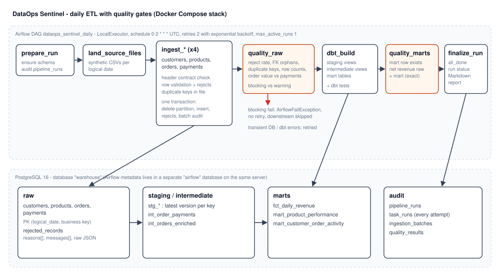
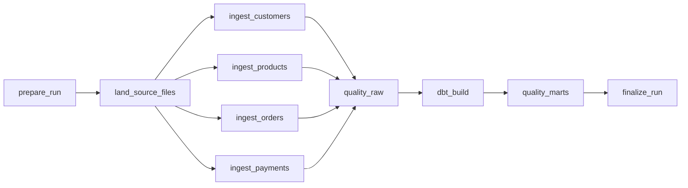
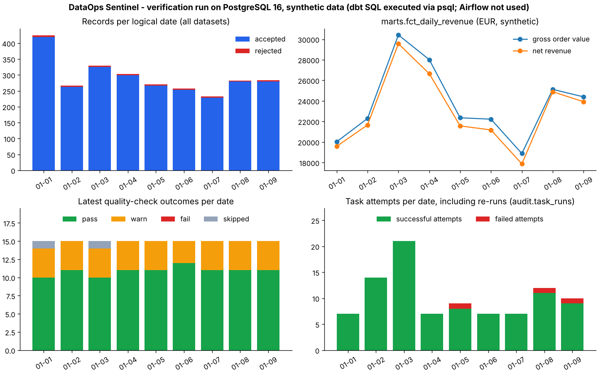

# DataOps Sentinel — Production-Style ETL Platform

[](https://github.com/bsdgsmm/dataops-sentinel/actions/workflows/ci.yml)

A production-inspired daily ETL platform for a fictional online marketplace. Customer,
product, order and payment files are validated, loaded into **PostgreSQL** in an idempotent
way, transformed with **dbt**, checked by data-quality gates and orchestrated by
**Apache Airflow**. Every run, attempt, rejected record and quality outcome is written to
audit tables and summarised in a generated report.

The project focuses on reliability: what happens when source data is invalid, a task fails
half-way, Airflow retries, or a historical date has to be reprocessed.

> **All data is synthetic.** It is produced by a deterministic generator
> (`src/dataops_sentinel/synthetic/generator.py`), every landing folder contains a
> `_SYNTHETIC_DATA.txt` marker, and none of it represents real customers or business results.
> This is a portfolio project, not a production-ready system.

## Contents

1. [Business problem](#1-business-problem)
2. [Architecture](#2-architecture)
3. [Pipeline lifecycle and task dependencies](#3-pipeline-lifecycle-and-task-dependencies)
4. [Source contracts and record validation](#4-source-contracts-and-record-validation)
5. [Data model and transformations](#5-data-model-and-transformations)
6. [Data-quality rules](#6-data-quality-rules)
7. [Idempotency strategy](#7-idempotency-strategy)
8. [Retry and recovery behaviour](#8-retry-and-recovery-behaviour)
9. [Backfills and reprocessing](#9-backfills-and-reprocessing)
10. [Monitoring and reporting](#10-monitoring-and-reporting)
11. [Local setup](#11-local-setup)
12. [Running the pipeline](#12-running-the-pipeline)
13. [Tests, linting and CI](#13-tests-linting-and-ci)
14. [Verification status and visuals](#14-verification-status-and-visuals)
15. [Known limitations](#15-known-limitations)
16. [Future improvements](#16-future-improvements)

## 1. Business problem

The marketplace receives one batch of files per day from its operational systems. Analysts
need trustworthy daily revenue, product performance and customer activity tables every
morning. The batches are not always clean: fields go missing, statuses are misspelled,
amounts are negative, files arrive without a column, or the database is briefly unavailable.

The platform has to:

* reject bad records without losing them, and stop the day when too much is wrong;
* never double-count when a day is loaded twice;
* survive a failure at any point and recover by re-running the same command;
* reprocess any historical date on request;
* show what happened in every run with real, recorded numbers.

## 2. Architecture



| Layer | Technology | Location |
|---|---|---|
| Orchestration | Apache Airflow 2.10 (LocalExecutor) | `dags/dataops_sentinel_daily.py` |
| Task logic | Python 3.12 package, independent of Airflow | `src/dataops_sentinel/` |
| Validation | Python record validation + SQL quality checks + dbt tests | `validation/`, `dbt/` |
| Storage | PostgreSQL 16 (`warehouse` database) | `sql/schema.sql` |
| Transformation | dbt Core 1.8 with dbt-postgres | `dbt/` |
| Reporting | Markdown report and PNG chart from audit tables | `reporting/`, `scripts/` |
| Local stack | Docker Compose: PostgreSQL, Airflow webserver, scheduler, init | `docker-compose.yml` |

**Why a Python validator plus dbt tests instead of Great Expectations?** Row-level rules
(types, formats, allowed statuses, timestamp windows, cross-field totals) have to run *before*
loading so that bad rows can be isolated into `raw.rejected_records` with a reason per row.
That is ~150 lines of plain Python that is easy to test. Dataset-level rules (foreign keys,
duplicates, row-count drift, revenue reconciliation) are SQL queries over the loaded data with
explicit blocking/warning severities, and model-level rules are dbt tests. Great Expectations
would add a large dependency and its own configuration format without adding a rule this
project needs.

The DAG file only wires tasks together. All logic lives in `dataops_sentinel.orchestration.tasks`,
which is also used by a command-line runner (`dataops_sentinel.orchestration.cli`) so the same
code path runs in Airflow, in CI and on a laptop.

## 3. Pipeline lifecycle and task dependencies



| Task | What it does | Retries |
|---|---|---|
| `prepare_run` | Applies `sql/schema.sql` (idempotent `CREATE ... IF NOT EXISTS`) and records the run in `audit.pipeline_runs`. | 0 |
| `land_source_files` | Writes the synthetic files for the logical date. Deterministic, so re-running produces identical files. Can be switched off with the `generate_synthetic_data` param when real files are delivered. | 0 |
| `ingest_<dataset>` | Reads the file, checks the header contract, validates each row, then replaces the partition in one transaction. The four datasets run in parallel. | 2 |
| `quality_raw` | Runs the raw-layer checks and stores every result. Blocking failures fail the task without retries. | 2 |
| `dbt_build` | `dbt build`: staging and intermediate views, mart tables, and all dbt tests. | 2 |
| `quality_marts` | Confirms the mart row for the date exists and that net revenue in the mart equals net revenue computed from raw payments. | 2 |
| `finalize_run` | `trigger_rule=all_done`: marks the run `success` or `failed`, writes `reports/pipeline_report_<date>.md`, and fails the DAG run if any task failed. | 1 |

**Schedule and time zone.** `schedule="0 2 * * *"` in UTC. The run that starts at 02:00 UTC on
day D+1 processes the UTC calendar day D (`data_interval_start`). Every task derives the date from
the Airflow context, never from the wall clock. `catchup=False` prevents Airflow from creating a
run for every day since the start date; history is processed deliberately with `airflow dags
backfill`. `max_active_runs=1` keeps dates in order because the row-count check compares a date
with the dates before it. Default task timeout is 15 minutes (30 for dbt); the DAG run times out
after one hour.

## 4. Source contracts and record validation

Each logical date has a folder `data/landing/<YYYY-MM-DD>/` with `customers.csv`,
`products.csv`, `orders.csv` and `payments.csv`. Contracts are defined in
`src/dataops_sentinel/ingestion/schemas.py`.

| Dataset | Business key | Required columns and rules |
|---|---|---|
| customers | `customer_id` (`C00000`) | email (format), full_name, country (one of 8 codes), created_at |
| products | `product_id` (`P0000`) | product_name, category, unit_price ≥ 0, updated_at |
| orders | `order_id` (`O00000000`) | customer_id, product_id, quantity ≥ 0, unit_price ≥ 0, order_total = quantity × unit_price (±0.01), status ∈ {placed, shipped, delivered, cancelled}, ordered_at within the logical date |
| payments | `payment_id` (`PAY00000000`) | order_id, amount ≥ 0, method ∈ {card, bank_transfer, wallet}, status ∈ {captured, refunded, failed}, paid_at within [D, D+2) |

Timestamps must be ISO-8601 with an explicit UTC offset; naive timestamps are rejected.
Decimals may have at most two places.

**File level (blocking, no retry).** A missing file or a missing required column raises
`SourceFileError`; nothing is written. Unexpected extra columns are accepted and recorded in
`audit.ingestion_batches.unexpected_columns`.

**Row level.** Every problem on a row is collected, not only the first one. Reason codes:
`missing_required_field`, `invalid_type`, `invalid_format`, `invalid_timestamp`,
`timestamp_out_of_range`, `invalid_status`, `negative_amount`, `inconsistent_total`,
`duplicate_key`, `malformed_row`. Rejected rows go to `raw.rejected_records` with the reasons,
messages and the original values as JSON. For duplicate business keys inside one file the first
valid occurrence is kept and later ones are rejected as `duplicate_key`.

## 5. Data model and transformations

**Raw (`raw.*`).** One table per dataset, primary key `(logical_date, business key)`, plus
`run_id` and `loaded_at` for lineage. The same customer, product or order can appear on several
dates (for example a price change); staging picks the latest version.

**Staging (views).** `stg_customers`, `stg_products`, `stg_orders`, `stg_payments`: latest
version per business key by `logical_date`, renamed columns, `order_date` = UTC date of
`ordered_at`.

**Intermediate (views).**
* `int_order_payments` — one row per order: captured, refunded, net paid amount and failed
  payment attempts.
* `int_orders_enriched` — orders joined with product category, customer country and payments;
  `is_revenue_order = status <> 'cancelled'`.

**Marts (tables).**

| Model | Grain | Metrics |
|---|---|---|
| `fct_daily_revenue` | UTC order date | orders_count, cancelled_orders, gross_order_value, captured_amount, refunded_amount, net_revenue, average_order_value, active_customers |
| `mart_product_performance` | product | orders_count, units_sold, net_revenue, cancellation_rate, last_order_date |
| `mart_customer_order_activity` | customer | first/last order date, orders_count, revenue_orders_count, lifetime_net_revenue, average_order_value, days_since_last_order |

**Metric definitions.**
* **Gross order value** — sum of `order_total` for orders that are not cancelled.
* **Captured amount** — sum of payments with status `captured` for orders placed on the date.
* **Refunded amount** — sum of payments with status `refunded` for those orders.
* **Net revenue** — captured amount minus refunded amount. Failed payment attempts are excluded.
  Revenue is attributed to the **date the order was placed**, not the date the money moved, so a
  refund that arrives later changes the net revenue of the original order date.
* **Average order value** — net revenue ÷ number of non-cancelled orders.
* **Units sold** — quantity on non-cancelled orders.
* **Cancellation rate** — cancelled orders ÷ all orders of the product.
* **Days since last order** — days between a customer's last order date and the latest order
  date in the data (not today's date, so historical reruns give stable results).

All amounts are synthetic EUR values; there is no currency conversion.

**dbt tests.** `unique` and `not_null` on every key, `accepted_values` for statuses and country
codes, `relationships` between orders/customers/products/payments, and two singular tests:
`assert_daily_revenue_reconciles_with_payments` and `assert_no_negative_revenue`. Foreign-key
`relationships` tests on staging use `severity: warn`, because orphan rows are allowed through
ingestion up to the threshold enforced by the raw quality gate (see below); a failing dbt test
of `error` severity fails `dbt_build` as a data-quality error.

Model documentation lives next to the models in `_staging.yml`, `_intermediate.yml` and
`_marts.yml` (`make dbt-docs`).

## 6. Data-quality rules

`quality_raw` runs after ingestion, `quality_marts` after dbt. Every result is stored in
`audit.quality_results` with severity, outcome (`pass`, `warn`, `fail`, `skipped`), observed
value, threshold and details. A **blocking** check with outcome `fail` stops the run; **warning**
checks and `warn` outcomes are reported only.

| Check | Severity | Rule (defaults, configurable via `SENTINEL_*` variables) |
|---|---|---|
| `reject_rate_<dataset>` | blocking | warn > 1 %, fail > 5 % rejected rows; skipped when the file is empty |
| `rejected_records_by_reason` | warning | counts per dataset and reason (missing fields, invalid timestamps, invalid statuses, negative amounts, …) |
| `all_datasets_loaded` | blocking | all four datasets have a batch for the date |
| `duplicate_business_keys` | blocking | no key stored twice in one partition |
| `orders_already_loaded_on_earlier_date` | warning | the same `order_id` arrived on an earlier date |
| `orders_customer_fk`, `orders_product_fk`, `payments_order_fk` | blocking | orphan share: warn > 0 %, fail > 5 % |
| `orders_row_count_change` | warning (blocking when 0 orders) | change vs. trailing average of up to 7 earlier dates; warn > 50 % |
| `order_value_vs_captured_payments` | blocking | non-cancelled order value vs. captured payments for the same orders; warn > 1 %, fail > 10 % |
| `mart_daily_revenue_row_present` | blocking | exactly one mart row for the date |
| `net_revenue_raw_vs_mart` | blocking | net revenue from raw payments equals the mart value exactly |

Orphan rows are usually a consequence of upstream rejections (an order whose customer row was
rejected). That is why foreign keys warn first and only block above 5 %.

## 7. Idempotency strategy

The unit of idempotency is a **partition = (dataset, logical date)**. `replace_partition`
(`src/dataops_sentinel/database/repository.py`) runs, in **one transaction**:

1. `DELETE` the dataset's rows for the logical date;
2. `DELETE` the dataset's rejected records for the date;
3. `INSERT` the newly accepted rows and rejected rows;
4. upsert the batch record in `audit.ingestion_batches` (primary key `(dataset, logical_date)`).

Consequences:

* Loading the same date twice gives the same rows, not twice the rows — tested in unit tests
  with an in-memory transaction model and in integration tests against PostgreSQL.
* If anything fails before the commit (database error, killed worker, injected fault), the
  transaction rolls back and the partition keeps its previous contents. There is no
  half-loaded state to clean up.
* Other dates are never touched, so a backfill of one date cannot disturb another.
* Primary keys on `(logical_date, business key)` are a second line of defence against
  duplicates within a partition.

Downstream, dbt rebuilds views and mart tables from the full raw layer on every run, so they are
idempotent by construction. Quality results are replaced per `(logical_date, stage)`.

What is **not** claimed: there is no exactly-once execution. Airflow may run a task more than
once (retries, manual clears, a worker lost after commit). The design makes repeated execution
harmless rather than impossible.

## 8. Retry and recovery behaviour

Errors are classified in `src/dataops_sentinel/errors.py`:

| Error | Examples | Behaviour |
|---|---|---|
| `TransientPipelineError` | lost connection, deadlock, lock timeout, dbt cannot connect or times out | Airflow retries: 2 retries, 1 min initial delay, exponential backoff up to 10 min |
| `SourceFileError` | missing file, missing column | `AirflowFailException`: fails immediately, no retries |
| `DataQualityError` | blocking check failed, dbt test failed | `AirflowFailException`: fails immediately, no retries |
| other `PermanentPipelineError` | SQL error, dbt compilation error | fails immediately, no retries |

Every attempt is written to `audit.task_runs` with its `try_number`, status, error type and
message, using autocommitted statements that are independent of the data transaction, so failed
attempts stay visible.

**Fault injection for demos.** `SENTINEL_FAULT_INJECTION=<task>@<date>:<mode>` (comma-separated)
makes a task fail on purpose. `transient_once` fails the first attempt just before the commit and
lets the retry succeed (a marker file in `data/state` remembers that it fired); `always` fails
every attempt. It is empty by default.

**Recovery scenarios** (all demonstrated in section 14):

| Scenario | What happens | How to recover |
|---|---|---|
| Recoverable task failure | `ingest_orders` fails before commit; previous data intact | Airflow retry, or re-run the task |
| Invalid source data | Too many rejected orders → `quality_raw` fails, downstream skipped, rejects stored | Fix or replace the files, clear the run |
| Contract violation | `orders.csv` without `status` → `ingest_orders` fails without retries | Deliver a correct file, clear the task |
| Partially completed run | Some ingest tasks done, one failed | Clear the failed task; completed partitions are simply replaced again if re-run |

## 9. Backfills and reprocessing

Any date can be reprocessed because ingestion replaces partitions and the generator can rebuild
any historical date on its own.

```bash
make backfill-airflow START=2026-01-01 END=2026-01-07
make backfill START=2026-01-02 END=2026-01-03
make rerun DATE=2026-01-03
```

The first command uses `airflow dags backfill` with `--reset-dagruns`. The other two use the
command-line runner with existing landing files. Dates are processed in order because the
row-count check looks at earlier dates; loading out of order still produces the same stored data
(covered by an integration test), only that warning check would compare against fewer dates.

## 10. Monitoring and reporting

| Information | Source |
|---|---|
| Run status, trigger, logical date, measured duration | `audit.pipeline_runs` |
| Records read / accepted / rejected per dataset and date | `audit.ingestion_batches` |
| Rejected rows with reasons and original values | `raw.rejected_records` |
| Quality checks with severity, outcome, observed value | `audit.quality_results` |
| Task attempts, errors, retries, measured duration | `audit.task_runs` |

`finalize_run` writes `reports/pipeline_report_<date>.md` after every DAG run, and
`make report START=… END=…` writes a report for a range. The report shows only values from these
tables: runs, records, warnings and failures, task errors, and tasks with more than one attempt.
Durations are `finished_at - started_at` as recorded by PostgreSQL; nothing is estimated. Airflow's
own UI and task logs remain the place for live status and log output.

`scripts/render_run_chart.py` renders the PNG in section 14 from the same tables and
`marts.fct_daily_revenue`.

## 11. Local setup

Requirements: Docker with Compose v2, GNU Make, Python 3.12+ for host-side commands and tests.

```bash
git clone https://github.com/bsdgsmm/dataops-sentinel.git
cd dataops-sentinel
make install
make up
```

`make up` copies `.env.example` to `.env` (placeholder passwords for a disposable local stack;
`.env` is git-ignored), builds the Airflow image with the package and a separate dbt virtual
environment, and starts:

| Service | Port (host) | Purpose |
|---|---|---|
| `postgres` | 5433 | PostgreSQL 16 with `warehouse` and `airflow` databases created by `docker/init-databases.sh` |
| `airflow-webserver` | 8080 | Airflow UI (user and password from `.env`) |
| `airflow-scheduler` | – | LocalExecutor scheduler |
| `airflow-init` | – | One-off database migration and admin user |

Inside Compose the services talk to `postgres:5432`; host-side commands use `localhost:5433`.
Data volumes: `postgres-data` (databases), `airflow-logs`; `./data` (landing files, fault
markers) and `./reports` are bind mounts.

dbt runs in its own virtual environment inside the Airflow image because dbt and Airflow pin
conflicting dependency versions. The package itself is installed against the official Airflow
2.10.4 constraints for Python 3.12.

## 12. Running the pipeline

**With Airflow:**

```bash
make backfill-airflow START=2026-01-01 END=2026-01-07
make demo-failure DATE=2026-01-08
make unpause
```

`demo-failure` runs one date with `SENTINEL_FAULT_INJECTION=ingest_orders@<DATE>:transient_once`;
the first `ingest_orders` attempt fails and the retry a minute later succeeds. Open
http://localhost:8080 to see task states and logs. Invalid source data can be tried the same way:

```bash
make backfill-airflow START=2026-01-09 END=2026-01-09 SCENARIO=dirty
make backfill-airflow START=2026-01-10 END=2026-01-10 SCENARIO=missing_column
make backfill-airflow START=2026-01-09 END=2026-01-10 SCENARIO=default
```

The first two runs fail at `quality_raw` and `ingest_orders` respectively, without retries; the
third replaces both dates with clean data.

**Without Airflow (same task code, sequential, no retries):**

```bash
make run START=2026-01-01 END=2026-01-07
make rerun DATE=2026-01-03
make demo-dirty DATE=2026-01-08
make report START=2026-01-01 END=2026-01-08
```

`make demo-dirty` first loads a dirty file for the date (the command exits with an error because
the quality gate blocks it), then loads clean data for the same date and succeeds.

**Inspect results:**

```bash
docker compose exec postgres psql -U sentinel -d warehouse -c "SELECT * FROM marts.fct_daily_revenue ORDER BY order_date"
docker compose exec postgres psql -U sentinel -d warehouse -c "SELECT logical_date, task_name, try_number, status, error_type FROM audit.task_runs ORDER BY started_at DESC LIMIT 20"
```

**Stop:** `make down` keeps the data; `make clean` deletes volumes, landing files and reports.

## 13. Tests, linting and CI

```bash
make test
make lint
make up
make test-integration
```

* **Unit tests** (`tests/unit`, no services needed): record validation against fixture files,
  duplicate handling, idempotent partition replacement and rollback (with an in-memory
  transaction model in `tests/fakes.py`), retry-safe ingestion with injected faults, quality-check
  evaluation and thresholds, revenue reconciliation, generator determinism and historical-date
  independence, dbt exit-code mapping, configuration and report rendering.
* **Integration tests** (`tests/integration`, skipped unless `SENTINEL_RUN_INTEGRATION=1`):
  * `test_pipeline_postgres.py` creates a throwaway PostgreSQL database and checks re-runs,
    rollback before commit, quality gates, dirty data, contract violations, out-of-order backfill,
    and — when `dbt` is installed — `dbt build` plus the mart revenue reconciliation;
  * `test_dag_definition.py` loads the DAG with a real Airflow installation and checks the task
    graph, schedule and retry settings.
* **Linting**: Ruff (Python) and SQLFluff (`sql/`, `dbt/models`, `dbt/tests`, Postgres dialect,
  Jinja templater with dbt built-ins).
* **CI** (`.github/workflows/ci.yml`): lint; unit tests on Python 3.12 and 3.13; a PostgreSQL
  service job that runs `dbt parse`, the PostgreSQL integration tests, a seven-day pipeline run
  with `dbt build`, a re-run, a dirty date that must be blocked, and publishes the generated
  report as a job summary and artifact; and an Airflow job that installs Airflow 2.10.4 with the
  official constraints and runs the DAG tests. No secrets or paid services are needed.

## 14. Verification status and visuals

What has been executed so far, and where:

| Check | Result |
|---|---|
| Ruff lint and format check, SQLFluff | Passed in CI |
| Unit tests (`tests/unit`, 66 tests) | Passed in CI on Python 3.12 and 3.13 |
| PostgreSQL integration tests, including `dbt build` and the mart revenue reconciliation | Passed in CI against a PostgreSQL 16 service container |
| Seven-day pipeline run with `dbt build`, a re-run, and a dirty date that must be blocked | Passed in CI; the generated report is published as the job summary and the `pipeline-report` artifact |
| Airflow 2.10.4 DAG import and structure tests | Passed in CI |
| Docker images and the full Compose stack (`make up`, `make demo-failure`) | **Not run yet**; build the stack locally to try the Airflow UI and retry demo |

**Local verification run.** Separately from CI, the task functions (`ingest_dataset`, `check_raw_quality`, `transform`,
`check_mart_quality`, the report) were executed against a local PostgreSQL 16 server for logical
dates 2026-01-01 to 2026-01-09. Because no PostgreSQL driver could be installed in that
environment, a small test-only adapter sent the statements through `psql`, and the dbt models
were rendered with Jinja (`ref`/`source` replaced by schema-qualified names) and executed in
dependency order, with their generic and singular tests translated to SQL. Results:

* Seven days of default data: 893 orders and 884 payments stored; re-running 2026-01-03 left
  row counts and total net revenue (158,095.99) unchanged.
* Injected failure before commit on `ingest_orders` for 2026-01-05: the partition kept its
  previous 131 rows and run id; the second attempt replaced it; `audit.task_runs` shows
  `1:failed, 2:success`.
* Dirty data for 2026-01-08 (19 of 143 order rows rejected): blocked by `reject_rate_orders` and
  `payments_order_fk`; loading clean data for the same date afterwards succeeded.
* `orders.csv` without the `status` column for 2026-01-09: rejected with `SourceFileError`
  before anything was written; a corrected file then loaded.
* Every mart check passed: net revenue from raw payments matched `fct_daily_revenue` exactly
  for each date.

The resulting report is committed as [docs/verification_run_report.md](docs/verification_run_report.md)
and the chart below was rendered from the same database by `scripts/render_run_chart.py`:



The task-attempt panel includes the deliberate re-runs of the verification scenario, which is
why some dates have more attempts than tasks.

## 15. Known limitations

* One order has one product line; there are no multi-item baskets or discounts.
* Single currency (synthetic EUR); no currency conversion.
* The raw layer keeps every version of every record; there is no retention policy yet.
* Marts are rebuilt in full on each run, which is fine for this volume but not for large data.
* Payments are accepted only within [D, D+2) of their file's logical date; a refund delivered
  weeks later in a new file would need a wider window or a separate refunds feed.
* The row-count check uses a simple trailing average and does not model weekly seasonality.
* LocalExecutor and a single PostgreSQL server: no high availability.
* Alerting is limited to Airflow task states and the generated report; nothing pages anyone.
* The default thresholds were chosen for the synthetic data and would need tuning on real data.

## 16. Future improvements

* Incremental dbt models partitioned by order date, with `--select` per logical date.
* dbt source freshness checks and snapshot tables for slowly changing customer attributes.
* Alerts (Slack or email callbacks) on blocking failures and repeated retries.
* A data-contract registry shared with producers instead of contracts in code.
* OpenLineage integration for column-level lineage in Airflow.
* Weekly-seasonality aware anomaly detection for row counts and revenue.

## License

[MIT](LICENSE)
